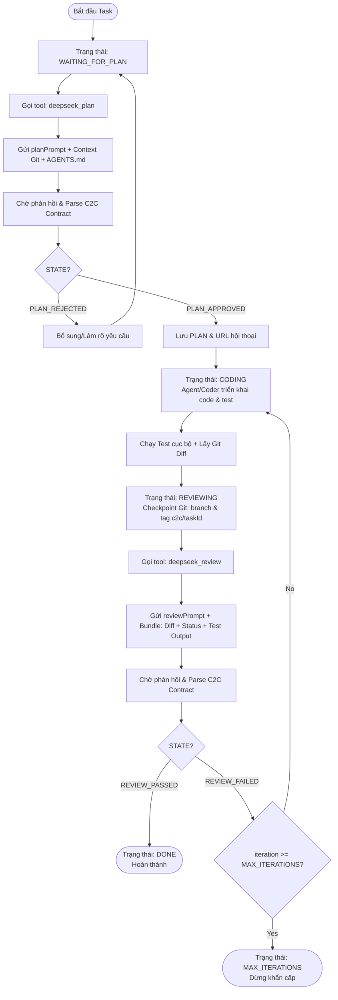
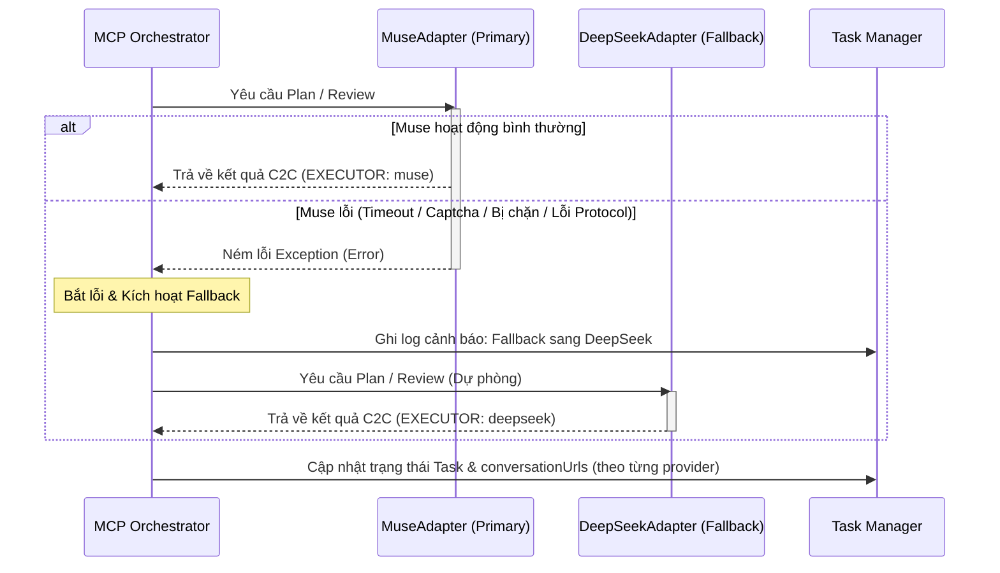

# KẾ HOẠCH KIẾN TRÚC & TÍCH HỢP MUSE (MUSE.AI) VÀO C2C WORKFLOW

> **Tài liệu**: Kế hoạch tích hợp Provider Muse song song & thay thế DeepSeek trong hệ thống C2C Agent  
> **Tác giả**: Kiến trúc sư phần mềm (Antigravity Software Architect)  
> **Trạng thái**: Bản dự thảo đề xuất (Chờ phê duyệt - Chưa can thiệp mã nguồn)  
> **Vị trí lưu trữ**: `C:\c2c\PLAN_MUSE.md`  
> **Ngày lập**: 16/10/2026  

---

## 1. TÓM TẮT KIẾN TRÚC HIỆN TẠI

Hệ thống **C2C (Chat-to-Code / Controller-to-Coder)** là mô hình cộng tác tự động giữa một **Planner/Reviewer AI** (đang sử dụng Web UI của DeepSeek thông qua giao thức Chrome DevTools Protocol) và một **Coding Agent / Orchestrator** (thực thi thay đổi mã nguồn cục bộ, chạy test và quản lý phiên bản Git).

### 1.1. Cấu trúc các Module trong `c2c-agent`

Toàn bộ mã nguồn cốt lõi nằm tại thư mục `C:\c2c-agent\src`, phân rã theo trách nhiệm đơn lẻ:

```
c2c-agent/
├── Chrome_Debug.bat          # Script khởi động Chrome remote debugging port 9222
├── package.json              # Khai báo phụ thuộc (@modelcontextprotocol/sdk, puppeteer-core, zod)
├── tasks/active/             # Thư mục lưu trữ trạng thái Task dưới dạng JSON file
├── logs/                     # Thư mục lưu log chi tiết của server và từng task
├── scripts/                  # PoC scripts kiểm thử nhanh tương tác trình duyệt & parser
└── src/
    ├── server/
    │   └── mcp-server.js     # MCP Server: Khởi tạo MCP tool, điều phối luồng hỏi-đáp, retry & lifecycle
    ├── deepseek/             # Tầng tương tác Web UI DeepSeek (Automation Adapter)
    │   ├── browser.js        # Quản lý Puppeteer kết nối CDP port 9222, định vị hoặc mở tab DeepSeek
    │   ├── selectors.js      # URL hằng số và bộ CSS Selectors của DeepSeek
    │   ├── sender.js         # Đưa prompt vào textarea và gửi lệnh submit (Enter)
    │   ├── reader.js         # Đếm câu trả lời, polling chờ marker C2C_END hoặc chờ text ổn định
    │   └── prompts.js        # Template xây dựng Prompt theo chuẩn C2C (planPrompt, reviewPrompt)
    ├── protocol/             # Định nghĩa giao thức truyền tin C2C
    │   ├── states.js         # Danh sách trạng thái hợp lệ & cấu hình MAX_ITERATIONS (mặc định: 5)
    │   ├── parser.js         # Bóc tách khối <<<C2C_BEGIN>>> ... <<<C2C_END>>> thành key-value
    │   └── validator.js      # Kiểm định tính toàn vẹn cấu trúc và logic chuyển trạng thái
    ├── workflow/             # Quản lý máy trạng thái và lưu trữ dữ liệu
    │   ├── state-machine.js  # Ma trận chuyển dịch trạng thái hợp lệ (canGo)
    │   └── task-manager.js   # CRUD trạng thái task (tệp .json tại tasks/active/<taskId>.json)
    └── utils/
        ├── git.js            # Tương tác git repo (ls-files, diff, status, checkpoint tag/branch)
        ├── paths.js          # Khai báo đường dẫn tĩnh của dự án
        └── log.js            # Ghi log thời gian thực ra file và console
```

---

### 1.2. Luồng Vòng Đời: PLAN -> CODE -> REVIEW

Toàn bộ quy trình vận hành xoay quanh máy trạng thái hữu hạn (FSM) và giao thức hợp đồng C2C:



1. **Khởi tạo & PLAN (`deepseek_plan`)**:
   - Nhận `task_id`, `task` (mô tả yêu cầu), `repository` (đường dẫn repo), `constraints` (ràng buộc).
   - Task được khởi tạo ở trạng thái `TASK_RECEIVED`, chuyển sang `WAITING_FOR_PLAN`.
   - Lấy ngữ cảnh repo (`git ls-files` tối đa 400 file, đọc `AGENTS.md`) đính kèm vào `planPrompt`.
   - Kết nối tới tab DeepSeek, gửi prompt.
   - Nhận phản hồi dạng hợp đồng `<<<C2C_BEGIN>>>...<<<C2C_END>>>`.
   - Nếu `PLAN_APPROVED`: Trích xuất mục `PLAN:` (các bước thực thi, tên class/file, test case). Trạng thái task chuyển thành `PLAN_APPROVED`. URL của phiên chat (`page.url()`) được lưu vào task để tái sử dụng trong các vòng lặp sau.
   - Nếu `PLAN_REJECTED`: Trích xuất mục `ISSUES:` để người dùng hoặc orchestrator giải trình thêm.

2. **CODE (Thực thi mã nguồn)**:
   - Dựa trên kế hoạch đã duyệt, Coder Agent/Developer thực hiện thay đổi file trong repository.
   - Chạy build và bộ kiểm thử tự động, gom toàn bộ `test_output` và `git_diff`.

3. **REVIEW (`deepseek_review`)**:
   - Nhận `task_id`, `test_output`, và `git_diff` (nếu không truyền, tự động gọi `git diff HEAD~1`).
   - Task chuyển từ `PLAN_APPROVED` (hoặc `REVIEW_FAILED`) sang `CODING` rồi tới `REVIEWING`.
   - Tự động tạo điểm phục hồi git (`checkpoint`): tạo commit trên nhánh `c2c/<taskId>` và đặt tag `c2c/<taskId>/iteration-<N>`.
   - Mở lại đúng URL hội thoại DeepSeek đã lưu trong task (`t.conversationUrl`) nhằm duy trì toàn bộ ngữ cảnh trao đổi trước đó.
   - Gửi bundle thông tin gồm: `GIT STATUS`, `GIT DIFF` (cắt tối đa 40,000 ký tự), và `TEST OUTPUT` (cắt tối đa 8,000 ký tự).
   - Nhận phản hồi:
     - `REVIEW_PASSED`: Chuyển task sang `DONE`, xuất `SUMMARY` và `TESTS`.
     - `REVIEW_FAILED`: Nếu đạt giới hạn 5 lần lặp (`MAX_ITERATIONS`), chuyển sang trạng thái dừng an toàn `MAX_ITERATIONS`. Nếu chưa, trả về `ISSUES` và `REQUIRED_FIXES` để tiếp tục sửa ở vòng lặp kế tiếp.

---

### 1.3. Cách Orchestrator điều khiển Chrome DevTools (CDP) & Cơ chế Tự khởi động

- **Mô hình kiến trúc**: `c2c-agent` không nhúng một phiên bản headless Chromium riêng biệt mà kết nối trực tiếp vào trình duyệt Google Chrome chính của người dùng thông qua **Chrome DevTools Protocol (CDP)** trên cổng `9222`.
- **Thống nhất thư mục Profile duy nhất**:
  - Toàn bộ dữ liệu phiên làm việc, cookie đăng nhập Google OAuth, LocalStorage của DeepSeek và Muse được **thống nhất lưu tại một thư mục duy nhất**: `C:\c2c\chrome-profile`.
  - Loại bỏ hoàn toàn việc phân tán sang `%USERPROFILE%\chrome-debug-profile`.
- **Cơ chế Tự động khởi động Chrome khi port 9222 chưa mở**:
  - Trước khi kết nối Puppeteer, module quản lý browser sẽ ping kiểm tra cổng debug qua HTTP endpoint `http://127.0.0.1:9222/json/version`.
  - Nếu kết nối thất bại (Chrome chưa chạy), orchestrator sẽ tự động thực thi `child_process.spawn` khởi chạy Chrome với đường dẫn chuẩn:
    ```bat
    "C:\Program Files\Google\Chrome\Application\chrome.exe" --remote-debugging-port=9222 --user-data-dir="C:\c2c\chrome-profile" https://chat.deepseek.com https://muse.ai
    ```
  - Quá trình này sẽ thăm dò (poll) định kỳ mỗi 500ms cho đến khi cổng 9222 phản hồi sẵn sàng (tối đa 10s) trước khi chuyển giao kết nối cho Puppeteer, giúp người dùng không bắt buộc phải nhớ mở file `.bat` thủ công.
- **Cơ chế điều khiển qua Puppeteer-core**:
  - `src/deepseek/browser.js` (và sau này là `src/browser/launcher.js`) dùng `puppeteer.connect({ browserURL: "http://127.0.0.1:9222", defaultViewport: null })`.
  - Quản lý tab: Duyệt qua `browser.pages()` để tìm tab tương ứng của provider. Nếu chưa có, mở tab mới hoặc điều hướng tab tới URL đích.
  - Giữ tab active bằng `page.bringToFront()`.

---

### 1.4. Cách thức gọi DeepSeek hiện tại

Toàn bộ logic tương tác nằm trong `src/deepseek/`:
- **`askWithRetry()`** (`src/server/mcp-server.js`):
  1. Đếm số lượng câu trả lời hiện tại (`before = await countAnswers(page)`).
  2. Gửi nội dung qua `sendPrompt(page, prompt)`.
  3. Chờ đợi câu trả lời hoàn tất qua `waitForAnswer(page, before)` với timeout 300,000ms (5 phút).
  4. Parse khối `<<<C2C_BEGIN>>>...<<<C2C_END>>>` qua `parseC2C()`.
  5. Validate dữ liệu qua `validate()`. Nếu sai format hoặc thiếu trường, tự động retry tối đa 2 lần với lời nhắc:
     > *"Your last response failed validation. You MUST answer ONLY with the <<<C2C_BEGIN>>>...<<<C2C_END>>> block containing the correct STATE and required fields. DO NOT include normal conversation text."*

---

### 1.5. Vai trò của tệp `plan.md`

Trong chu trình kiến trúc của agentic coding:
- `plan.md` là tài liệu chứa nội dung `PLAN:` đã được Reviewer AI phê duyệt.
- Hiện tại trong `c2c-agent`, nội dung `PLAN` được lưu trữ tập trung tại trường `lastMessage.PLAN` trong tệp `tasks/active/<taskId>.json` và trả về payload cho caller.
- Tuy nhiên, trong quy trình chuẩn hóa của dự án repo mục tiêu (được định nghĩa trong các tài liệu chỉ dẫn như `AGENTS.md`), file `plan.md` đóng vai trò là "bản vẽ thi công" đặt tại thư mục làm việc để coding sub-agents đọc và đối chiếu khi thực hiện bước CODE.
- Kế hoạch mới sẽ đồng bộ hóa: Sau khi có `PLAN_APPROVED`, hệ thống tự động ghi hoặc hỗ trợ xuất `plan.md` vào thư mục của task/repo.

---

## 2. LIỆT KÊ NHỮNG PHẦN ĐANG GẮN CỨNG (HARDCODED) VỚI DEEPSEEK

Hiện tại hệ thống gắn chặt với DeepSeek ở nhiều tầng, khiến việc thay thế hoặc bổ sung nhà cung cấp khác gặp trở ngại nếu không refactor:

| Tầng (Layer) | Tệp tin / Vị trí | Chi tiết phần bị gắn cứng | Tác động khi đổi provider |
| :--- | :--- | :--- | :--- |
| **URL & Navigation** | `src/deepseek/selectors.js`<br>`src/deepseek/browser.js`<br>`Chrome_Debug.bat` | • `URL_HOME = "https://chat.deepseek.com/"`<br>• `p.url().startsWith("https://chat.deepseek.com")`<br>• Khởi động Chrome mặc định mở DeepSeek | Khi sang Muse, trình duyệt sẽ không nhận diện được tab Muse, nhảy sai trang hoặc mở tab mới liên tục |
| **DOM Selectors** | `src/deepseek/selectors.js` | • `SEL.input = "textarea"`<br>• `SEL.answer = ".ds-markdown"` | Nếu Muse sử dụng `div[contenteditable="true"]` hoặc class chat khác (vd: `.muse-response`, `.markdown-body`), việc tìm kiếm sẽ văng Exception |
| **Cơ chế Input / Submit** | `src/deepseek/sender.js` | • Chờ `page.waitForSelector("textarea")`<br>• Sử dụng `HTMLTextAreaElement.prototype` descriptor setter<br>• Gửi bằng phím Enter: `page.keyboard.press("Enter")` | Nếu Muse dùng Rich Editor dạng `contenteditable`, setter `HTMLTextAreaElement` sẽ không chạy; nếu Muse yêu cầu click nút Send hoặc dùng `Ctrl+Enter` thì lệnh gửi sẽ thất bại |
| **Nhận diện hoàn thành** | `src/deepseek/reader.js` | • Selector đếm phần tử: `.ds-markdown`<br>• Lấy phần tử cuối cùng `els[els.length - 1].innerText`<br>• Kiểm tra điều kiện hoàn thành: `info.text.includes("<<<C2C_END>>>")` | Nếu Muse không có class `.ds-markdown` hoặc cấu trúc DOM chia tin nhắn theo từng block con, hàm đọc sẽ trả về rỗng hoặc timeout |
| **Hợp đồng Protocol & Thông điệp** | `src/deepseek/prompts.js`<br>`src/server/mcp-server.js` | • Trường bắt buộc: `EXECUTOR: deepseek`<br>• Thông báo lỗi tiếng Việt gắn tên DeepSeek: *"Có thể DeepSeek đang yêu cầu giải Captcha"*, *"TIMEOUT: DeepSeek không trả lời kịp"* | Không phản ánh đúng provider đang chạy, gây hiểu nhầm khi theo dõi log và debug |
| **API Công cụ MCP** | `src/server/mcp-server.js` | • Tên công cụ: `deepseek_plan`<br>• Tên công cụ: `deepseek_review` | Client/IDE Agent bị khóa chặt vào tên công cụ mang thương hiệu DeepSeek |

---

## 3. ĐỀ XUẤT KIẾN TRÚC TÍCH HỢP MUSE (MUSE.AI)

Mục tiêu: Đưa Muse vào hệ thống với tư cách là một Provider hoàn toàn bình đẳng với DeepSeek, có thể thay thế hoàn toàn hoặc chạy song song với cơ chế dự phòng tự động (Auto-Fallback).

### 3.1. Thiết kế Interface chung (`ChatProvider`)

Áp dụng mẫu thiết kế **Adapter Pattern** và **Strategy Pattern**, tách rời logic nghiệp vụ khỏi chi tiết giao diện web của từng nhà cung cấp.

```mermaid
classDiagram
    class ChatProvider {
        <<interface / base class>>
        +String name
        +String homeUrl
        +Object selectors
        +init(browser)
        +open(conversationUrl) Page
        +sendPrompt(page, text) Promise~void~
        +waitForResponse(page, beforeCount, options) Promise~String~
        +readResponse(page) Promise~String~
        +countAnswers(page) Promise~Number~
        +isAvailable(page) Promise~Boolean~
    }

    class DeepSeekAdapter {
        +name = "deepseek"
        +homeUrl = "https://chat.deepseek.com/"
        +selectors = { input: "textarea", answer: ".ds-markdown" }
        +sendPrompt(page, text)
        +waitForResponse(page, beforeCount, options)
    }

    class MuseAdapter {
        +name = "muse"
        +homeUrl = "https://muse.ai/..."
        +selectors = { input: "...", answer: "...", sendButton: "..." }
        +sendPrompt(page, text)
        +waitForResponse(page, beforeCount, options)
    }

    class ProviderFactory {
        +getPrimaryProvider() ChatProvider
        +getFallbackProvider() ChatProvider
        +getProviderByName(name) ChatProvider
    }

    ChatProvider <|-- DeepSeekAdapter
    ChatProvider <|-- MuseAdapter
    ProviderFactory --> ChatProvider : tạo và cung cấp
```

#### Chi tiết hợp đồng interface `ChatProvider`:
```javascript
// src/providers/base-provider.js
export class ChatProvider {
  constructor(config) {
    this.name = config.name;
    this.homeUrl = config.homeUrl;
    this.selectors = config.selectors;
    this.timeoutMs = config.timeoutMs || 300000;
  }

  /**
   * Mở hoặc định vị tab phù hợp trên trình duyệt.
   * @param {Browser} browser 
   * @param {string|null} conversationUrl 
   * @returns {Promise<Page>}
   */
  async open(browser, conversationUrl = null) { throw new Error("Chưa cài đặt open()"); }

  /**
   * Đưa prompt vào khung chat và thực thi lệnh gửi.
   * @param {Page} page 
   * @param {string} text 
   * @returns {Promise<void>}
   */
  async sendPrompt(page, text) { throw new Error("Chưa cài đặt sendPrompt()"); }

  /**
   * Đếm số lượng phản hồi hiện tại của mô hình trong trang.
   * @param {Page} page 
   * @returns {Promise<number>}
   */
  async countAnswers(page) { throw new Error("Chưa cài đặt countAnswers()"); }

  /**
   * Chờ phản hồi hoàn thành (qua marker C2C_END hoặc UI stop-generating).
   * @param {Page} page 
   * @param {number} beforeCount 
   * @param {object} options 
   * @returns {Promise<string>}
   */
  async waitForResponse(page, beforeCount, options = {}) { throw new Error("Chưa cài đặt waitForResponse()"); }

  /**
   * Đọc nội dung phản hồi hoàn chỉnh.
   * @param {Page} page 
   * @returns {Promise<string>}
   */
  async readResponse(page) { throw new Error("Chưa cài đặt readResponse()"); }
}
```

---

### 3.2. Cấu hình linh hoạt qua File Config / Biến Môi trường (Zero-Code Change)

Tạo tệp cấu hình trung tâm `c2c.config.json` đặt tại thư mục gốc `C:\c2c-agent\` (kèm hỗ trợ ghi đè qua biến môi trường hoặc tệp `.env`). Người dùng có thể chuyển đổi qua lại giữa Muse và DeepSeek mà không cần chạm vào bất kỳ dòng mã nguồn nào.

```json
{
  "active_provider": "muse",
  "enable_fallback": true,
  "fallback_provider": "deepseek",
  "cdp": {
    "host": "127.0.0.1",
    "port": 9222
  },
  "providers": {
    "muse": {
      "name": "muse",
      "home_url": "https://muse.ai/chat",
      "url_prefix": "https://muse.ai",
      "timeout_ms": 300000,
      "selectors": {
        "input": "div[contenteditable='true'], textarea#prompt-textarea",
        "submit_button": "button[type='submit'], button[aria-label='Send']",
        "answer_container": ".muse-chat-message-assistant, [data-message-author-role='assistant']",
        "generating_indicator": ".generating, button[aria-label='Stop generating']"
      }
    },
    "deepseek": {
      "name": "deepseek",
      "home_url": "https://chat.deepseek.com/",
      "url_prefix": "https://chat.deepseek.com",
      "timeout_ms": 300000,
      "selectors": {
        "input": "textarea",
        "submit_button": null,
        "answer_container": ".ds-markdown",
        "generating_indicator": null
      }
    }
  }
}
```

---

### 3.3. Các hạng mục kỹ thuật bắt buộc khảo sát trên Muse (muse.ai)

Trước khi viết adapter cho Muse, cần thực hiện một buổi khảo sát thực tế (Spike/Survey) trên giao diện Web của Muse:

1. **Xác định chính xác URL & Định tuyến**:
   - URL gốc của tính năng chat AI trên `muse.ai` (ví dụ: `https://muse.ai/chat`, `https://muse.ai/workspace/ai`, hoặc giao diện web trợ lý riêng).
   - Cơ chế lưu trữ phiên chat: Khi bắt đầu chat mới, URL có tự sinh UUID (ví dụ: `https://muse.ai/c/<uuid>`) như DeepSeek/ChatGPT để lưu vào `conversationUrl` hay không?
2. **Cơ chế xác thực & Duy trì phiên đăng nhập**:
   - Đăng nhập bằng Google OAuth hay Email/Password?
   - Phiên đăng nhập (Session cookie / LocalStorage token) tồn tại trong bao lâu? Có thường xuyên xuất hiện màn hình xác thực lại hoặc Captcha của Cloudflare không?
3. **Phân tích DOM Ô nhập liệu (Input)**:
   - Thẻ HTML thực tế: Là `<textarea>` thông thường hay là thẻ Rich Text `<div contenteditable="true">` (như Quill, Slate, Lexical, ProseMirror)?
   - Hành vi nhập dữ liệu: Gán `.value` có nhận không, hay cần dispatch `InputEvent`, hay phải dùng Clipboard API (`execCommand('insertText')`) hoặc phương thức bàn phím `page.keyboard.type()`?
4. **Cơ chế gửi lệnh (Submit)**:
   - Thao tác gửi mặc định là nhấn `Enter` hay click nút bấm (Submit Button)?
   - Trạng thái của nút gửi khi rỗng (disabled) và khi có text.
5. **Cơ chế phát hiện "Đã trả lời xong"**:
   - Muse có trạng thái streaming phản hồi theo thời gian thực không?
   - Các dấu hiệu trực quan trong DOM:
     - Xuất hiện nút "Stop generating" và sau đó biến mất khi xong.
     - Biểu tượng con trỏ nhấp nháy (`.typing-cursor`, `.blinking`) biến mất.
     - Thuộc tính `aria-busy="false"` trên container tin nhắn.
   - Kiểm tra xem Muse có nuốt mất ký tự đặc biệt của marker `<<<C2C_END>>>` không.
6. **Giới hạn độ dài đầu vào (Input Context Window)**:
   - Khi `c2c-agent` gửi `reviewPrompt`, nội dung `bundle` (bao gồm Git status, diff, test output) có thể dài từ **10,000 đến 45,000 ký tự**.
   - Cần thử nghiệm: Ô chat của Muse có giới hạn độ dài ký tự tối đa (maxlength) không? Nếu gửi quá dài có bị báo lỗi *"Message too long"* không?
7. **Xử lý Code Block & Định dạng Markdown**:
   - Muse bọc phản hồi trong thẻ `<pre><code>` hay render Markdown tự do?
   - Cần đảm bảo parser `parseC2C` trích xuất chính xác các trường `PLAN:`, `ISSUES:`, `REQUIRED_FIXES:` mà không bị lỗi newline do CSS wrapping.

---

### 3.4. Cơ chế Dự phòng Thông minh (Automatic Fallback to DeepSeek)

Nhằm đảm bảo quy trình tự động không bị đứt gãy giữa chừng khi Muse gặp sự cố, hệ thống sẽ thực hiện chuyển đổi dự phòng thông minh (Graceful Degradation):



- **Điều kiện kích hoạt Fallback**:
  1. Không tìm thấy ô nhập liệu sau timeout (nghi ngờ bị văng đăng nhập hoặc dính Captcha).
  2. Bị từ chối do độ dài ký tự vượt quá giới hạn của Muse.
  3. Gặp lỗi rate limit / hết quota câu hỏi trong ngày.
  4. Hết thời gian chờ phản hồi (Timeout > 5 phút).
  5. Sau 2 lần `askWithRetry` mà Muse vẫn không trả về đúng định dạng `<<<C2C_BEGIN>>>`.

- **Hành động chuyển đổi & Đảm bảo tính toàn vẹn ngữ cảnh (Context Continuity)**:
  - **Lưu trữ `conversationUrls` đa nhà cung cấp**:
    - Thay thế trường `conversationUrl` đơn lẻ thành cấu trúc map:
      ```json
      "conversationUrls": {
        "muse": "https://muse.ai/...",
        "deepseek": "https://chat.deepseek.com/a/chat/s/..."
      }
      ```
    - Khi tương tác với provider nào, hệ thống mở đúng URL của provider đó.
  - **Đính kèm `PLAN:` đã duyệt vào prompt của Fallback Provider**:
    - Khi fallback xảy ra ở bước **REVIEW** (ví dụ Muse đã tạo PLAN trước đó nhưng bước REVIEW bị lỗi và phải chuyển sang DeepSeek, hoặc DeepSeek chưa có ngữ cảnh hội thoại cũ): Hệ thống **bắt buộc trích xuất nội dung `PLAN:` đã được duyệt** từ `task.lastMessage.PLAN` (hoặc file `plan.md`) và chèn vào prompt review:
      ```
      ===== APPROVED PLAN (FROM PREVIOUS PHASE) =====
      ${approvedPlan}
      ```
    - Nhờ đó, Provider dự phòng hiểu đầy đủ ngữ cảnh ban đầu đã thống nhất, không bị đánh giá sai lệch hay từ chối review.
  - **Audit & Logging**:
    - Không ngắt task; tự động đánh dấu cờ `used_fallback = true`, ghi log cảnh báo chi tiết lý do fallback.
    - Cập nhật `EXECUTOR: deepseek` (hoặc provider dự phòng) tương ứng với kết quả trả về.

---

## 4. KẾ HOẠCH TRIỂN KHAI THEO CÁC BƯỚC NHỎ

Kế hoạch được chia thành 5 giai đoạn độc lập, kiểm thử từng phần trước khi tích hợp vào luồng chính:

```
┌────────────────────────────────────────────────────────────────────────┐
│ BƯỚC 1: Khảo sát thực tế & PoC tương tác Muse qua CDP (Spike)         │
└──────────────────────────────────┬─────────────────────────────────────┘
                                   ▼
┌────────────────────────────────────────────────────────────────────────┐
│ BƯỚC 2: Refactor Interface `ChatProvider` & `DeepSeekAdapter`          │
└──────────────────────────────────┬─────────────────────────────────────┘
                                   ▼
┌────────────────────────────────────────────────────────────────────────┐
│ BƯỚC 3: Xây dựng `MuseAdapter` & Hệ thống Cấu hình Config/Env          │
└──────────────────────────────────┬─────────────────────────────────────┘
                                   ▼
┌────────────────────────────────────────────────────────────────────────┐
│ BƯỚC 4: Hiện thực Cơ chế Auto-Fallback & Đa hình MCP Tools             │
└──────────────────────────────────┬─────────────────────────────────────┘
                                   ▼
┌────────────────────────────────────────────────────────────────────────┐
│ BƯỚC 5: Kiểm thử E2E Toàn diện trên Repository mẫu (`Learn_English`)  │
└────────────────────────────────────────────────────────────────────────┘
```

---

### Giai đoạn 1: Khảo sát thực tế, Tự động kích hoạt Chrome Debug & Viết Script PoC cho Muse [✅ HOÀN THÀNH]

- **Mục tiêu**:
  - Tự động kiểm tra và khởi chạy Chrome ở cổng debug `9222` với profile thống nhất `C:\c2c\chrome-profile` nếu cổng chưa mở.
  - Xác định các selector DOM, URL, cơ chế gửi/nhận tin nhắn thực tế trên `muse.ai` bằng thực nghiệm với Chrome.
  - Viết script `poc-muse.js` kiểm chứng khả năng tương tác.
  - **Điểm dừng phê duyệt (Gate Check)**: Dừng lại và báo cáo toàn bộ selector thực tế của Muse cho User trước khi tiến hành code Giai đoạn 2.
- **Tệp cần tạo / sửa**:
  - Tạo mới: `C:\c2c-agent\scripts\poc-muse.js` (Script chạy độc lập: tự ping/bật Chrome nếu cần, mở trang Muse, gửi câu hỏi "Reply with exactly: HELLO", và đọc kết quả).
  - Cập nhật: `C:\c2c-agent\Chrome_Debug.bat` (Thống nhất cờ `--user-data-dir="C:\c2c\chrome-profile"`).
- **Kết quả thực tế (Đã xác minh ngày 16/10/2026)**:
  - Selector input: `textarea[aria-label="Nhắn tin"]`
  - Selector send: `button[aria-label="Gửi"][data-pel-click="chat_send_message"]`
  - Selector stop: `button[aria-label="Dừng"]`
  - Selector assistant messages: `[data-message-item="true"][data-message-role="assistant"]`
  - Message ID tracking: thuộc tính `data-message-id` trên message item

---

### Giai đoạn 2: Tách Interface `ChatProvider` & Đóng gói `DeepSeekAdapter` [✅ HOÀN THÀNH]

- **Mục tiêu**: Refactor mã nguồn hiện có của DeepSeek thành một Adapter chuẩn hóa, giữ nguyên 100% tính năng và độ ổn định của hệ thống hiện tại.
- **Tệp đã tạo / sửa**:
  - `C:\c2c-agent\src\providers\base.js` (`ChatProvider` base class).
  - `C:\c2c-agent\src\providers\deepseek-adapter.js` (Đóng gói logic từ `src/deepseek/`).
  - `C:\c2c-agent\src\providers\index.js` (Factory `getProvider()` đọc `process.env.CHAT_PROVIDER`).
  - `C:\c2c-agent\src\server\mcp-server.js` (Dùng `getProvider()`, quản lý `conversationUrls` đa provider).
- **Tiêu chí hoàn thành (DoD)**:
  - DeepSeek chạy trơn tru qua kiến trúc Provider Interface; Zero regression.

---

### Giai đoạn 3: Phát triển `MuseAdapter` & Hỗ trợ Chuyển đổi Provider [✅ HOÀN THÀNH]

- **Mục tiêu**: Hoàn thiện `MuseAdapter` dựa trên selector thực tế, hỗ trợ protocol C2C và xử lý virtual DOM list.
- **Tệp đã tạo / sửa**:
  - `C:\c2c-agent\src\providers\muse-adapter.js` (Hiện thực hóa trọn vẹn `ChatProvider` cho Muse).
  - `C:\c2c-agent\src\protocol\parser.js` (Thêm khả năng bóc tách linh hoạt kể cả khi AI quên in delimiters).
  - `C:\c2c-agent\src\deepseek\prompts.js` (Nhấn mạnh bắt buộc bao gồm delimiters trong prompt).
  - `C:\c2c-agent\scripts\test-muse-e2e.js` (Kiểm thử tự động End-to-End trọn vẹn gửi & nhận C2C contract thành công 100%).
- **Tiêu chí hoàn thành (DoD)**:
  - Muse nhận prompt C2C, trả về khối `<<<C2C_BEGIN>>>...<<<C2C_END>>>` hợp lệ và parse thành công.

---

### Giai đoạn 3: Phát triển `MuseAdapter` & Tích hợp Tệp Cấu hình `c2c.config.json`

- **Mục tiêu**: Hoàn thiện `MuseAdapter` dựa trên kết quả khảo sát từ Bước 1; hỗ trợ chuyển đổi provider thông qua file config.
- **Tệp cần tạo / sửa**:
  - Tạo mới: `C:\c2c-agent\c2c.config.json` (Chứa cấu hình active provider và selectors).
  - Tạo mới: `C:\c2c-agent\src\utils\config.js` (Module nạp và validate file cấu hình).
  - Tạo mới: `C:\c2c-agent\src\providers\muse-adapter.js` (Hiện thực `ChatProvider` cho Muse).
  - Chỉnh sửa: `C:\c2c-agent\src\protocol\validator.js` (Chấp nhận `EXECUTOR: muse` song song với `EXECUTOR: deepseek`).
  - Chỉnh sửa: `C:\c2c-agent\src\deepseek\prompts.js` (Tham số hóa trường `EXECUTOR: ${providerName}` thay vì hardcode `deepseek`).
- **Cách test**:
  1. Thiết lập trong `c2c.config.json`: `"active_provider": "muse"`.
  2. Tạo script `scripts/test-muse-c2c.js` gửi thử một prompt hợp đồng C2C (yêu cầu tạo file dummy).
  3. Kiểm tra xem `parseC2C` có bóc tách thành công và `validator` có chấp nhận `EXECUTOR: muse` không.
- **Tiêu chí hoàn thành (DoD)**:
  - Muse nhận diện được prompt C2C, trả về khối `<<<C2C_BEGIN>>>...<<<C2C_END>>>` hợp lệ và được parse thành công.

---

### Giai đoạn 4: Triển khai Tự động Fallback & Bổ sung Alias MCP Tools

- **Mục tiêu**: Xây dựng khả năng chịu lỗi (Resilience) tự động chuyển sang DeepSeek khi Muse gặp sự cố, đồng thời cung cấp công cụ MCP mang tính trung lập (Provider-Agnostic).
- **Tệp cần tạo / sửa**:
  - Chỉnh sửa: `C:\c2c-agent\src\server\mcp-server.js`:
    - Bổ sung logic `executeWithFallback(actionFn, task)`: Nếu active provider thất bại, thử lại ngay với fallback provider.
    - Đăng ký thêm 2 tool chuẩn hóa: `c2c_plan` và `c2c_review`.
    - Giữ lại `deepseek_plan` và `deepseek_review` dưới dạng Alias (chuyển tiếp sang `c2c_plan`/`c2c_review`) để duy trì tính tương thích ngược tuyệt đối.
  - Chỉnh sửa: `C:\c2c-agent\src\workflow\task-manager.js` (Bổ sung trường `provider` và `fallbackUsed` vào JSON task để tiện audit).
- **Cách test**:
  1. Giả lập tình huống lỗi của Muse (ví dụ cấu hình sai URL của Muse hoặc ngắt tab Muse trong khi tab DeepSeek vẫn mở).
  2. Kích hoạt gọi tool `c2c_plan`.
  3. Kiểm tra log: Hệ thống phải báo lỗi Muse, ghi nhận fallback và hoàn thành việc sinh plan bằng DeepSeek.
- **Tiêu chí hoàn thành (DoD)**:
  - Hệ thống tự động phục hồi và hoàn thành tác vụ khi provider chính bị gián đoạn; log ghi nhận rõ ràng quá trình fallback.

---

### Giai đoạn 5: Kiểm thử Toàn diện E2E trên Repository mẫu (`Learn_English`)

- **Mục tiêu**: Xác thực toàn bộ chu trình thực tế PLAN -> CODE -> REVIEW với Muse đóng vai trò chính trên một bài toán lập trình cụ thể.
- **Tệp tham gia**:
  - Thư mục kiểm thử: `C:\REPO_HOCTAP\Learn_English`.
  - Tệp chỉ dẫn: `C:\REPO_HOCTAP\Learn_English\AGENTS.md` (Cập nhật tài liệu hướng dẫn dùng `c2c_plan` / `c2c_review`).
- **Quy trình test**:
  1. Khởi tạo task mới `test-muse-01`: "Viết hàm tính chỉ số BMI trong file `bmi.js` và test suite trong `bmi.test.js`".
  2. Chạy `c2c_plan` -> Nhận PLAN từ Muse -> Kiểm tra trạng thái task `PLAN_APPROVED`.
  3. Coding agent viết code theo plan.
  4. Chạy `npm test` lấy test output.
  5. Chạy `c2c_review` -> Gửi diff và test output tới Muse -> Nhận `REVIEW_PASSED`.
  6. Kiểm tra git tag và snapshot được lưu đúng trên repo.
- **Tiêu chí hoàn thành (DoD)**:
  - Toàn bộ luồng đi từ `TASK_RECEIVED` đến `DONE` trơn tru; tệp `tasks/active/test-muse-01.json` được cập nhật đầy đủ lịch sử với `EXECUTOR: muse`.

---

## 5. PHÂN TÍCH RỦI RO & CHIẾN LƯỢC GIẢM THIỂU

| STT | Rủi ro tiềm ẩn | Mức độ | Nguyên nhân | Chiến lược giảm thiểu (Mitigation Strategy) |
| :---: | :--- | :---: | :--- | :--- |
| **1** | **Thay đổi Giao diện Web (UI Changes)** | Cao | Các nền tảng Web AI thường xuyên cập nhật frontend (đổi class CSS, cấu trúc DOM) khiến selector bị hỏng. | • Tách toàn bộ selector ra tệp cấu hình `c2c.config.json`.<br>• Không dùng class hash động ngẫu nhiên; ưu tiên dùng semantic selectors (`role`, `aria-label`, `data-testid`, placeholder).<br>• Thiết kế selector dạng danh sách ưu tiên (Array of Fallback Selectors), thử lần lượt selector 1 -> selector 2. |
| **2** | **Xác thực Captcha / Cloudflare Bot Guard** | Cao | Thao tác tự động hóa với tần suất cao có thể kích hoạt cơ chế chống bot của Cloudflare Turnstile hoặc reCAPTCHA. | • **Không dùng Puppeteer headless** tự sinh. Dùng trực tiếp Chrome người dùng (`Chrome_Debug.bat`) với profile thật đã lưu cookie.<br>• Khi phát hiện màn hình chặn, bắt exception và phát âm thanh/ghi log nổi bật: *"Vui lòng mở Chrome giải Captcha trong 30 giây"*.<br>• Nếu sau 30 giây không giải, tự động kích hoạt Fallback sang provider còn lại. |
| **3** | **Đăng nhập hết hạn (Session Expired)** | Trung bình | Phiên làm việc (Session) của Muse hoặc DeepSeek hết hạn sau vài ngày, đưa người dùng về trang Login. | • Trong hàm `isAvailable()`, kiểm tra xem có sự hiện diện của nút "Sign in" / "Log in" hay không trước khi gửi prompt.<br>• Nếu phát hiện bị đăng xuất, ghi log cảnh báo và tự động chuyển sang Fallback Provider thay vì để tiến trình bị treo. |
| **4** | **Rate Limit / Hết Quota (Usage Limits)** | Cao | Muse có thể có giới hạn số lượng tin nhắn mỗi giờ hoặc giới hạn token cho tài khoản miễn phí/trả phí. | • Nhận diện các thông báo lỗi đặc trưng trên UI của Muse (vd: *"You have reached your limit"*, *"Too many requests"*).<br>• Ngay khi bắt được dấu hiệu này, hệ thống tự động ghi nhận Muse bị tạm khóa và chuyển toàn bộ các bước tiếp theo trong task sang DeepSeek. |
| **5** | **Giới hạn Độ dài Input (Prompt Truncation)** | Trung bình | Bundle dữ liệu review (bao gồm Git Diff và Test Output) quá dài khiến ô chat của Muse từ chối nhận. | • Sử dụng hàm `clip()` thông minh: nén các file diff không trọng yếu, loại bỏ các file lock (`package-lock.json`), chỉ giữ lại diff liên quan trực tiếp đến mã nguồn.<br>• Nếu phát hiện prompt vượt ngưỡng an toàn của Muse (ví dụ > 20,000 ký tự), tự động tóm tắt diff hoặc chuyển thẳng sang DeepSeek (vốn có context window lớn hơn). |
| **6** | **Vi phạm định dạng giao thức C2C** | Trung bình | Model của Muse có thể thêm lời chào đầu/kết bài hoặc quên đóng khối `<<<C2C_END>>>`. | • Áp dụng kỹ thuật `askWithRetry` tối đa 2 lần với lời nhắc chấn chỉnh nghiêm khắc (Strict Enforcement).<br>• Tối ưu prompt trong `prompts.js` để nhấn mạnh yêu cầu: *"Bắt buộc chỉ trả về duy nhất một khối C2C, không kèm văn bản nào khác"*. |

---

## 6. KẾT LUẬN & ĐỀ XUẤT TIẾP THEO

- Kiến trúc hiện tại của `c2c-agent` rất tinh gọn, mạch lạc và đã tách biệt tốt tầng giao thức (`protocol/`) với tầng điều phối (`workflow/`).
- Điểm nghẽn duy nhất là sự gắn kết chặt chẽ (tight coupling) giữa tầng Automation và DeepSeek tại thư mục `src/deepseek/` và tên gọi các công cụ MCP.
- Việc refactor sang mô hình **Provider Interface** không chỉ giúp tích hợp thành công **Muse**, mà còn mở ra khả năng mở rộng không giới hạn cho các Web AI khác trong tương lai (Claude Web, ChatGPT Web, Gemini Web) hoặc chuyển đổi sang Direct API khi có nhu cầu.

> [!IMPORTANT]
> **Cam kết**: Toàn bộ mã nguồn hiện tại của dự án được giữ nguyên vẹn 100%. Quá trình triển khai sẽ chỉ bắt đầu khi bản kế hoạch này được Người dùng (User) rà soát và chính thức phê duyệt.
